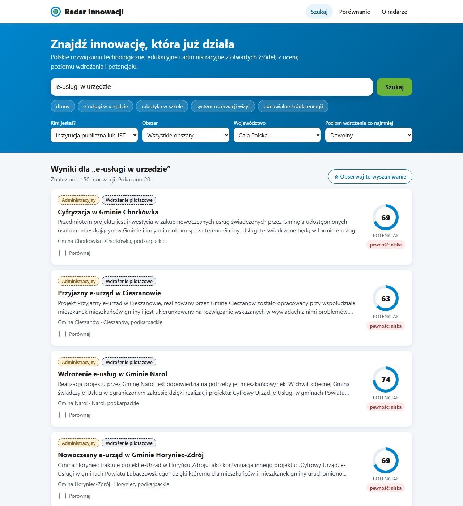
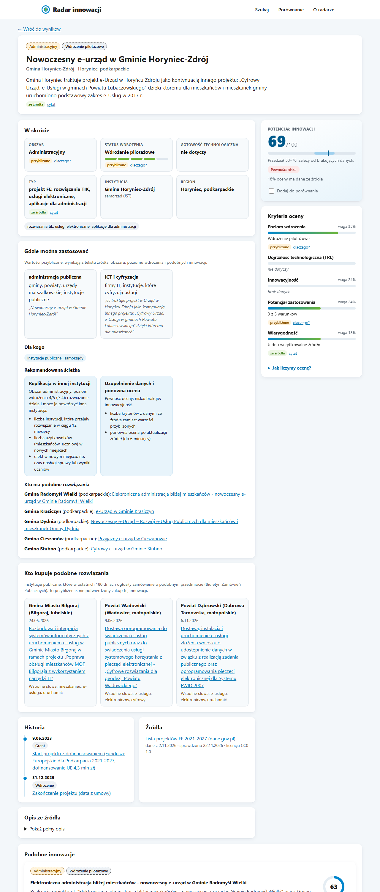

# InnovationHub

🏆 Winning solution of the "Radar innowacji" challenge of the Podkarpackie Centrum Innowacji (PCI) at HackNation 2026 (Bydgoszcz, 21–22 November 2026).

InnovationHub finds Polish innovations that already exist: technological, educational and administrative. It reads open data sources, gives each innovation a score with open criteria and shows who can use it. The user interface is in Polish.



## How it works

- **Automatic discovery.** Eight modules in `src/sources/` read open data sets, APIs and web pages. Nobody must submit an innovation by hand.
- **Open criteria.** Five criteria give a potential score from 0 to 100: implementation level, TRL, novelty, application potential and credibility. All scales and weights are in `src/criteria.py`.
- **A range, not a false precision.** A criterion without data does not count as zero. The score is a range with a confidence level, and the card shows which data is not available.
- **Source values apart from estimates.** Each value has a quote and a link to its source. An estimated value has a label and a reason.
- **Demand signals.** The card shows public institutions that announced a similar tender in the last 180 days.
- **No language model.** Rules and a full-text search on Polish lemmas (SQLite FTS5, BM25) do all the work. The application needs no GPU and no paid service.



## Data sources

All sources are free and need no API key.

| Source | Content | License |
|---|---|---|
| EU funds projects 2021–2027 (dane.gov.pl) | approximately 36,500 projects | CC0 1.0 |
| RAD-on (OPI PIB) | patents and research projects of Polish science units | CC0 1.0 |
| Interreg 2021–2027 (dane.gov.pl) | approximately 100 cross-border projects | CC0 1.0 |
| Kohesio (European Commission) | completed EU projects 2014–2020 in Poland | reuse rules of the European Commission |
| EPO Linked Open Data | approximately 1,160 European patents of Polish applicants | CC BY 4.0 |
| NCBR success stories | approximately 310 completed projects | not given; the application keeps only a quote and a link |
| "Innowacyjny Samorząd" competition | awarded projects of local governments | publisher rights; the application keeps only a quote and a link |
| BZP (e-Zamówienia) | tenders of public institutions (demand signals) | free use |

## Quick start

To start the application with Docker, do these steps:

1. Build the image:

   ```bash
   docker build -t innovationhub .
   ```

2. Build the database. The first run takes approximately 20 minutes, because the sources need pauses between requests:

   ```bash
   docker run -v "$(pwd)/data/cache:/app/data/cache" innovationhub python -m src.pipeline update --voivodeship podkarpackie
   ```

3. Start the application:

   ```bash
   docker run -p 8000:8000 -v "$(pwd)/data/cache:/app/data/cache" innovationhub
   ```

4. Open http://127.0.0.1:8000.

To start the application without Docker, install [uv](https://docs.astral.sh/uv/) and run these commands:

```bash
uv venv --python 3.13 .venv
uv pip sync --python .venv requirements.txt
uv run --no-project python -m src.pipeline update --voivodeship podkarpackie
uv run --no-project uvicorn src.app:app
```

To run the tests, run `uv run --no-project python -m pytest`. The tests need no network.

## More information

The full description in Polish is in [`docs/DETAILS.pl.md`](docs/DETAILS.pl.md). It gives the rules of the score, the data sources, the limits, the API and the licenses of all components.

## Team

Team CombAIns: [MikolajRowicki](https://github.com/MikolajRowicki), [MaciejMomot](https://github.com/MaciejMomot) and [FilipLangiewicz](https://github.com/FilipLangiewicz).

## License

[EUPL-1.2](LICENSE)
